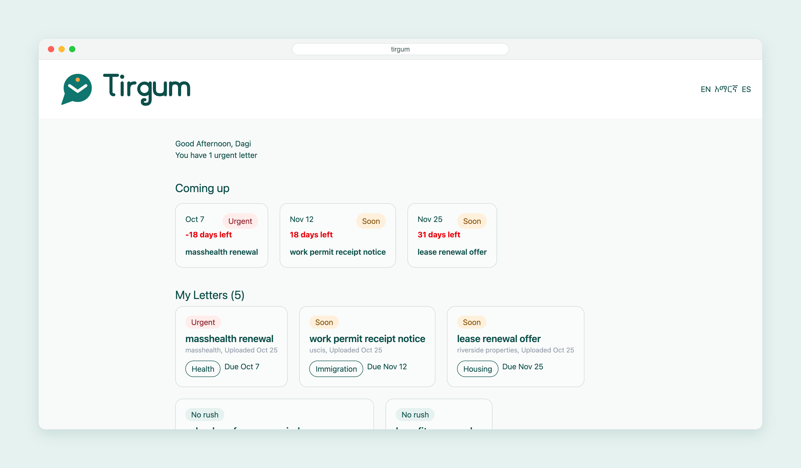

# Tirgum

Tirgum is a letter-organizing app. The current version includes a dashboard that displays saved letters, urgency labels, deadlines, and a short list of upcoming deadlines.

## Dashboard mockup



## Current status

- `GET /` redirects to `/dashboard`.
- `GET /dashboard` loads letters from MongoDB and renders the dashboard.
- `GET /dashboard?filter=urgent` shows urgent letters.
- Letter upload and individual letter detail pages are not implemented yet.

## Run locally

1. Install dependencies:

   ```bash
   npm install
   ```

2. Set the following values in `config/.env`:

   ```env
   PORT=3000
   MONGODB_CONNECTIION=mongodb://127.0.0.1:27017/tirgum
   ```

   Replace the MongoDB URL with your own connection string if needed. The environment variable name is spelled `MONGODB_CONNECTIION` in the current app configuration.

3. Start the server:

   ```bash
   npm start
   ```

4. Open [http://localhost:3000](http://localhost:3000).

To add the sample letters to the database, run:

```bash
npm run seed
```

To rebuild the Tailwind stylesheet after changing templates or CSS input:

```bash
npm run build:css
```
