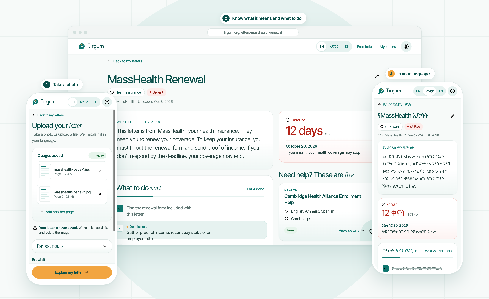

<p align="center">
  
</p>

# Tirgum

Tirgum is a letter-organizing web app. It keeps saved letters in one place, labels how urgent each one is, tracks deadlines, and points you to organizations that can help you respond.



## Table of Contents

- [Features](#features)
- [Tech Stack](#tech-stack)
- [Getting Started](#getting-started)
- [Usage](#usage)
- [Routes](#routes)
- [Project Structure](#project-structure)
- [Scripts](#scripts)
- [License](#license)

## Features

- Dashboard of letters with urgency labels and deadlines.
- Upcoming deadlines list for quick reference.
- Filter to show only urgent letters (`/dashboard?filter=urgent`).
- Help modal with organizations that can assist with a letter.
- Letter detail view.
- Sample letter and help organization seed data.

## Tech Stack

- [Node.js](https://nodejs.org/) and [Express](https://expressjs.com/)
- [MongoDB](https://www.mongodb.com/) with [Mongoose](https://mongoosejs.com/)
- [EJS](https://ejs.co/) templates
- [Tailwind CSS](https://tailwindcss.com/)

## Getting Started

### Prerequisites

- Node.js and npm
- A running MongoDB instance (local or hosted)

### Installation

1. Clone the repository and install dependencies:

   ```bash
   git clone https://github.com/dagmawitesfay/Tirgum.git
   cd Tirgum
   npm install
   ```

2. Create `config/.env` with the following values:

   ```env
   PORT=3000
   MONGODB_CONNECTIION=mongodb://127.0.0.1:27017/tirgum
   ```

   Replace the MongoDB URL with your own connection string if needed. The variable name is spelled `MONGODB_CONNECTIION` in the current app configuration.

3. (Optional) Seed the database with sample letters and help organizations:

   ```bash
   npm run seed
   ```

4. Start the server:

   ```bash
   npm start
   ```

5. Open [http://localhost:3000](http://localhost:3000).

## Usage

Visit `/dashboard` to see your saved letters. Use the urgent filter to focus on time-sensitive mail, open a letter to see its details, and use the help modal to find organizations that can assist.

## Routes

| Method | Path                  | Description                              |
| ------ | --------------------- | ---------------------------------------- |
| GET    | `/`                   | Landing page                             |
| GET    | `/dashboard`          | Dashboard of saved letters               |
| GET    | `/dashboard?filter=urgent` | Urgent letters only                 |
| GET    | `/letters/:id`        | Detail view for a single letter          |

## Project Structure

```
Tirgum/
├── config/        # Database and app configuration
├── controllers/   # Route handlers
├── models/        # Mongoose models (Letter, Help, User)
├── public/        # Static assets (CSS, images)
├── routes/        # Express routes
├── scripts/       # Seed scripts
├── views/         # EJS templates
└── server.js      # App entry point
```

## Scripts

| Command             | Description                                  |
| ------------------- | -------------------------------------------- |
| `npm start`         | Start the server with nodemon                |
| `npm run seed`      | Add sample data to the database              |
| `npm run build:css` | Build the Tailwind stylesheet                |
| `npm run watch:css` | Rebuild the stylesheet on changes            |

## License

Distributed under the ISC License.
